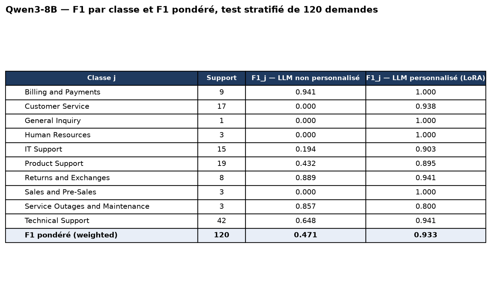

# Classification multilingue de demandes de support par un LLM

Projet de validation de la formation **LLM Engineer** (BLENT) : classer automatiquement des demandes de support client écrites en **5 langues** (de, en, es, fr, pt) dans **10 files de traitement** (`queue`), avec un LLM **open weights personnalisé** (`Qwen/Qwen3-8B` + adaptateur **LoRA**), et le comparer au même LLM **non personnalisé**. Tout s'exécute en local sur un **DGX Spark** : aucune API tierce.

## Résultat en une image


| Version du LLM (même test stratifié de 120 demandes) | F1 pondéré | IC95 % bootstrap |
|---|---|---|
| **Non personnalisé** (Qwen3-8B, prompt avec définitions des files) | **0,471** | [0,380 ; 0,572] |
| **Personnalisé** (Qwen3-8B + LoRA, graine 0 désignée à l'avance) | **0,933** | [0,884 ; 0,975] |

Exigence de l'énoncé : F1 pondéré du LLM personnalisé **≥ 92 %** → atteinte par le modèle de référence. **Lire les réserves ci-dessous** : trois entraînements donnent 0,933 / 0,908 / 0,916 (moyenne 0,919), et une grande partie du score vient de quasi-doublons entre entraînement et test.

## Contraintes du projet et réponse apportée
| Contrainte | Réalisation |
|---|---|
| LLM open weights | `Qwen/Qwen3-8B` ; comparaison aussi avec le `Qwen3.8-27B` servi par vLLM (sans personnalisation) |
| **Seules 5 colonnes** utilisables | `usecols` dans [`classif/data.py`](classif/data.py) : `id`, `answer`, `type`, `priority`, `tag_1…9` ne sont jamais chargées |
| Comparer LLM **non personnalisé** / **personnalisé** | Même modèle de base, même test, même code d'inférence ; seul l'adaptateur LoRA change |
| F1 par classe et **F1 pondéré** (formule de l'énoncé) | [`classif/evaluation.py`](classif/evaluation.py) calcule `F1_j = 2TP/(2TP+FP+FN)` et `Σ α_j F1_j`, vérifiés contre scikit-learn |
| **Test stratifié** | 120 tickets (20 %), écart de proportion de classes ≤ 0,33 point par rapport au jeu initial ([`resultats/stratification.csv`](resultats/stratification.csv)) |
| F1 personnalisé **≥ 92 %** | 0,933 (graine de référence) ; moyenne des 3 graines 0,919 |
| **Capture d'écran** des F1_j et du F1 pondéré, deux versions | [`resultats/capture_f1_scores.png`](resultats/capture_f1_scores.png) (produite par le notebook 04) |

## Les 3 étapes du projet
| Étape | Réalisation | Où |
|---|---|---|
| **1. Dataset d'entraînement et de test** | Découpage train 384 / val 96 / test 120 stratifié sur `queue` ; prompts construits depuis les 4 champs d'entrée ; exemples d'entraînement au format chat (JSONL) | [`classif/data.py`](classif/data.py), [`prompts/`](prompts) · [notebook 01](notebooks/01_environnement_donnees.ipynb), [02](notebooks/02_construction_dataset.ipynb) |
| **2. Personnalisation du LLM** | Fine-tuning supervisé **LoRA** (rang 16, toutes les projections linéaires), perte sur la seule réponse ; hyperparamètres choisis sur la validation, puis réentraînement sur train + val avec 3 graines | [`classif/finetune.py`](classif/finetune.py) · [notebook 03](notebooks/03_personnalisation_llm.ipynb) |
| **3. Évaluation et comparaison** | Les deux versions sur le même test, F1 par classe et pondéré, intervalles bootstrap, matrices de confusion, stabilité (3 graines), contrôle des quasi-doublons, points de comparaison sans personnalisation | [`classif/evaluation.py`](classif/evaluation.py), [`hf_model.py`](classif/hf_model.py) · [notebook 04](notebooks/04_evaluation_comparaison.ipynb) |

## Réserves à connaître (détaillées dans [docs/RAPPORT.md](docs/RAPPORT.md))
- **Quasi-doublons** : les 600 demandes sont en grande partie des variantes et des traductions les unes des autres. 73 % des tickets de test ont dans l'entraînement un voisin très proche (similarité `bge-m3` ≥ 0,90), 28 % une quasi-copie (≥ 0,95). Un simple **plus proche voisin sans LLM** obtient **0,975** de F1 pondéré sur ce test, plus que le LLM personnalisé. Sur les 32 tickets de test sans quasi-doublon, le LLM personnalisé classe juste dans **84 %** des cas (contre 44 % sans personnalisation) : bon gain, mais c'est une estimation sur peu de tickets.
- **Marge faible sur le seuil** : test de 120 tickets, IC95 % du F1 pondéré [0,884 ; 0,975] ; sur 3 entraînements, 2 passent sous 0,92 (0,908 ; 0,916). Le seuil est atteint par le modèle désigné à l'avance, pas de façon robuste.
- **Étiquettes bruitées** : les files dépendent de choix d'opérateurs, pas du sujet seul. Aucun modèle sans personnalisation ne peut les deviner (0,47 ; le 27B fait ≈ 0,43).
- **Petites classes** : *General Inquiry* n'a qu'un ticket de test ; le F1 de ces classes est quasi anecdotique.
- Le portugais est la langue la plus faible (F1 0,75 sur 15 tickets).

## Structure du dépôt
| Dossier | Contenu |
|---|---|
| [`prompts/`](prompts) | **Templates de prompts** (livrable central), décrits dans [`prompts/README.md`](prompts/README.md) |
| [`classif/`](classif) | Code Python : données et découpage, prompts, inférence locale, fine-tuning LoRA, évaluation, client vLLM |
| [`notebooks/`](notebooks) | 4 notebooks **exécutés avec leurs sorties** (`.ipynb`) et exports `.html` |
| [`data/`](data) | Jeu fourni (`helpdesk_customer_tickets.csv`), découpages (`splits/`), exemples d'entraînement (`sft/`) |
| [`resultats/`](resultats) | Capture des F1, tableaux par classe, prédictions du test, recherche d'hyperparamètres, stabilité, contrôle des quasi-doublons |
| [`docs/`](docs) | [Énoncé](docs/ENONCE.md), [rapport](docs/RAPPORT.md), [support de soutenance](docs/SOUTENANCE.md), [runbook JupyterLab](docs/RUNBOOK_JUPYTERLAB.md) |
| [`evidence/`](evidence) | `nvidia-smi` (preuve de l'environnement) |

## Exécution
Prérequis : un GPU (≈ 25 Go libres pour l'entraînement), Python 3.12 ; un LLM compatible OpenAI sur `http://localhost:8000/v1` seulement pour la ligne de comparaison « 27B de référence » du notebook 04.
```bash
python3 -m venv .venv && .venv/bin/pip install torch --index-url https://download.pytorch.org/whl/cu130   # adapter à votre CUDA
.venv/bin/pip install -r requirements.txt
.venv/bin/python -m ipykernel install --user --name classif-support --display-name "Python 3 (classif-support)"
cd notebooks && ../.venv/bin/jupyter lab        # exécuter 01 → 02 → 03 (≈ 2 h) → 04
```
Les adaptateurs LoRA (`modeles/`, ≈ 170 Mo chacun) ne sont pas versionnés : le notebook 03 les régénère. Les résultats publiés ont été produits sur le DGX Spark (GPU GB10, Qwen3-8B en bf16) ; l'entraînement n'étant pas bit-à-bit reproductible, un nouveau run donnera des scores proches mais pas identiques (cf. variabilité entre graines).

## Données
Jeu fourni par la formation : 600 demandes (`helpdesk_customer_tickets.csv`), 10 files, 5 langues, 4 secteurs d'activité. Le fichier contient d'autres colonnes (tags, priorité, réponse…) qui **ne sont jamais lues** par le code.

## Licence
MIT — voir [LICENSE](LICENSE).
